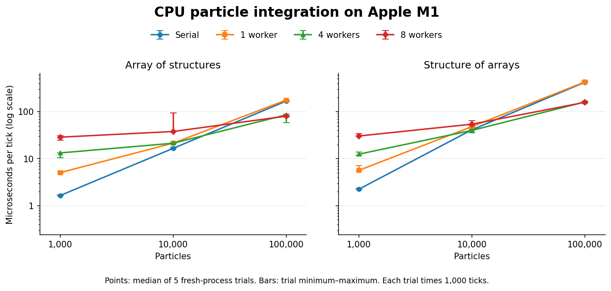

# CPU particle baseline — Milestone 19

**At 100,000 particles on the Apple M1, eight-worker AoS averaged 80.46 µs per tick at the median trial, compared with 167.98 µs for serial AoS (2.09×).** At 1,000 and 10,000 particles, serial AoS was fastest by median. These measurements cover the validated constant-acceleration update only; they are not Studio frame times, collision benchmarks or GPU results.



## What was measured

The [Milestone 18 particle rules](particle-workload.md) are unchanged: six float32 scalars per particle, seed 7, fixed 1/120-second simulation ticks, constant acceleration, finite-result checks and transactional state swaps. **AoS** stores the six scalars together per particle. **SoA** stores each component in its own contiguous float vector. Both keep initial, current and scratch state and share the arithmetic kernel and contiguous-range dispatch code. Neither path converts layouts inside the timed loop. Parallel execution uses a persistent pool; the one-worker pool is a useful comparison for the cost of going through the job system.

For each trial the driver starts a fresh process, constructs the state and pool, warms up for 60 ticks, resets to the original state, then measures 1,000 ticks using `steady_clock`. The timed batch includes finite checks, state swaps and, where applicable, task submission and waiting. Initialization, pool creation, warmup/reset, memory sampling, conversion to a common snapshot, serial reference replay, comparison and serialization are outside timing. The result is emitted only if every final position/velocity scalar equals the serial AoS reference. Separate tests compare states at each tick and exercise worker failure/recovery. Workers are not pinned; there are no throughput pass/fail thresholds.

There were five trials per configuration (120 fresh processes). Within each trial round, configuration order was shuffled with a recorded order seed of 19. All trials used the same workload seed. Results below are medians of **batch elapsed time divided by measured ticks**. Ranges represent variation among trial means, not individual-tick latency percentiles. The clock's reported tick period is not an empirical accuracy guarantee.

## Results on this machine

Microseconds per simulation tick, **lower is better**:

| Particles | Layout | Serial | 1 worker | 4 workers | 8 workers |
|---:|---|---:|---:|---:|---:|
| 1,000 | AoS | 1.65 | 5.05 | 13.27 | 28.72 |
| 1,000 | SoA | 2.24 | 5.65 | 12.49 | 30.40 |
| 10,000 | AoS | 16.62 | 21.42 | 21.34 | 37.90 |
| 10,000 | SoA | 41.19 | 48.08 | 40.00 | 54.22 |
| 100,000 | AoS | 167.98 | 176.40 | 85.72 | 80.46 |
| 100,000 | SoA | 422.49 | 428.86 | 161.06 | 158.18 |

The pool's submission/waiting path costs more than it saves at the smallest size. At 100K, four-worker AoS reached 1.96× serial AoS and eight workers reached 2.09× (ratios of median tick times). Four-worker trials ranged from **58.67 to 89.03 µs** and eight-worker trials from **76.98 to 81.32 µs**; their overlap does not support a general claim that eight workers outperform four. The ten-thousand-particle eight-worker AoS case also had a high trial at 94.98 µs (median 37.90). No samples were discarded.

AoS was faster than SoA for the 100K serial and parallel configurations on this machine. This update accesses all six fields, and the result describes these particular checked kernels, buffering choices, scheduler and compiler. We did not measure cache misses, memory bandwidth, SIMD utilization or per-core activity. No particular microarchitectural cause or CUDA layout choice follows from these timings.

## Memory

| Particles | Owned vector capacity (both layouts) | Range of median process peak RSS across configurations |
|---:|---:|---:|
| 1,000 | 72,000 bytes | 1.39–1.59 MiB |
| 10,000 | 720,000 bytes | 2.23–2.56 MiB |
| 100,000 | 7,200,000 bytes | 10.55–10.86 MiB |

Owned capacity sums the actual vector capacities for all three states, excluding allocator overhead. Separately, the runner samples `getrusage(RUSAGE_SELF).ru_maxrss` before constructing the simulation, after warmup/reset, and immediately after timing (before reference/snapshot allocations). This is a process-lifetime **high-water mark**, including earlier setup temporaries, resident portions of thread stacks, executable and runtime memory. It cannot establish per-allocation usage, live heap size, or how much memory was released. Fresh processes prevent a prior trial's peak from becoming the current trial's result. RSS is normalized to bytes according to the [Linux man page](https://man7.org/linux/man-pages/man2/getrusage.2.html) and [Darwin kernel manual](https://github.com/apple/darwin-xnu/blob/main/bsd/man/man2/getrusage.2). On other platforms unavailable RSS is exported as JSON null or a blank CSV field.

## Reproduce or inspect

```sh
cmake -S . -B build-m19-release -DCMAKE_BUILD_TYPE=Release -DCORESIM_BUILD_APP=OFF
cmake --build build-m19-release --parallel
ctest --test-dir build-m19-release --output-on-failure
./build-m19-release/coresim_particle_benchmark --layout soa --backend parallel --workers 4 --particles 100000 --seed 7 --format json
./build-m19-release/coresim_particle_benchmark --layout aos --backend serial --particles 100000 --seed 7 --format csv
python3 benchmarks/particle_study.py --binary build-m19-release/coresim_particle_benchmark --output /tmp/coresim-particle-study
```

The study driver requires an unsanitized Release binary, validates timings, task counts, buffer sizes, RSS ordering and digest agreement, and publishes only complete studies to a new directory. Parameters, shuffled sequence, compiler/build metadata, machine details, binary SHA256, source revision at run and effective compilation commands are retained. Use `--help` for bounds and overrides. Plotting is optional: `python3 benchmarks/plot_particles.py /tmp/coresim-particle-study /tmp/particles.png` requires Matplotlib. The benchmark and study driver do not.

The retained run used **Apple M1, 8 logical CPUs, 8 GiB RAM, macOS 26.3.1, AppleClang 21, arm64 Release**, with clean source revision `ee1c254`. See [metadata and compiler commands](../benchmarks/results/particles-m19/metadata.json), [all 120 raw trials in CSV](../benchmarks/results/particles-m19/trials.csv) or [JSON](../benchmarks/results/particles-m19/trials.json), and [group summaries with ranges](../benchmarks/results/particles-m19/summary.csv). This is one host and five trials per case. Background load and power/thermal behavior were not controlled. Future GPU comparisons must distinguish transfer, kernel and end-to-end time and validate numerical equivalence on hardware.
