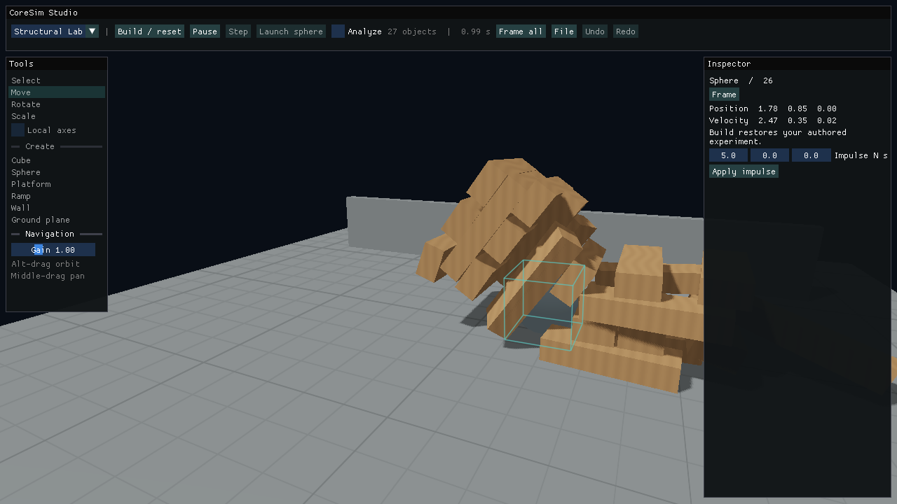

# Studio redesign implementation report

Studio now starts in **Structural Lab**. From the same application, a user can build a separate sandbox, pick and manipulate rigid bodies, set their initial motion and surface properties, play the experiment at 120 Hz, reset it, and save/reopen it without writing code. The [user guide](studio.md) includes the launch command, controls, file format and sample scenes. The [audit and implementation plan](studio-redesign-plan.md) records the starting architecture and phase gates.

| Phase | Delivered | Code checkpoint |
|---|---|---|
| 1 — Interactive foundation | New physical sandbox, six primitives, nearest collider picking, selection bounds, three axis tools, editable body/transform/surface inspector, separate authored and simulated motion. | `0d1c0fd` |
| 2 — Visual overhaul | Material-batched lighting, five finishes, procedural floor grid, directional shadow map with filtered sampling, tone mapping and display gamma, MSAA request, orbit/pan/dolly and framing. | `62f69f2` |
| 3 — Physics quality | Supported editor bodies sleep after sustained low linear/angular motion and wake on force, contact motion or support loss. Corrected visible self-shadow striping found during framebuffer review. | `2740568` |
| 4 — Flagship simulation | Editable 24-beam physical structure, heavy launchable sphere, mass/velocity controls, selected-body impulses, sphere–oriented-box collision support, repeatable impact/reset. | `d5b8725` |
| 5 — Product polish | Versioned scene files, atomic replacement of loaded worlds, bounded object command history, keyboard controls, compact live diagnostics, samples and UI interaction tests. | `95aaf58` |

## Architecture and files changed

- **Scene and editor ownership:** `src/studio/SandboxEditor.cpp` and its public header separate authored records from runtime components. The editor borrows its scene's World; entities are generation checked and command records use logical keys that survive delete/undo. Transforms, collider dimensions, rigid bodies and mesh finish are installed together. Scene creation/reset changes are in `src/scene/DemoScene.cpp`, `SceneConfig.cpp`, their headers and `src/studio/StudioSession.cpp`. Editing occurs between joined physics updates, and is locked while inspecting a simulation.
- **Input and UI:** `src/ui/EditorPanel.cpp`, `StudioPanel.cpp`, their headers, `src/core/Application.cpp`, `Window.cpp`, and `src/main.cpp` implement the viewport, palette, inspector, authoring workflow and launch default. Picking uses an inverse projection/view ray, sphere intersection, oriented-box local slabs and the oriented plane equation. World/local translation and rotation use axis-projected drags; size is always local. UI input suppresses viewport picking and text editing suppresses shortcuts.
- **Rendering:** `Renderer.cpp/.hpp`, `scene/Components.hpp`, `cube.vert`, `instanced.vert`, `cube.frag`, and new `shadow.vert/.frag` add the facility path. Editor instances are grouped by mesh and finish. The depth pass reuses instanced geometry; the color pass applies directional/ambient lighting, roughness-dependent highlights, a metallic approximation, 3×3 shadow filtering, tone mapping and gamma encoding. Legacy meshes retain their original colors and individual/instanced paths. Shadow resources are allocated lazily and released with the renderer.
- **Physics:** `RigidBody.cpp/.hpp`, `Integration.cpp`, `Contact.cpp`, `PhysicsSystem.cpp/.hpp` and `CollisionSystem.cpp/.hpp` implement body gravity, resting/waking and mixed sphere/box contacts. The existing angular solver, restitution threshold, friction constraints, broad phase and positional correction are reused. A regression first exposed the missing sphere/box case: the projectile crossed the tower without moving beams. The fix finds the closest point in box-local space and handles an embedded sphere via the nearest exit face. The test now requires momentum transfer. No scripted body animation is involved.
- **Persistence:** `SceneFile.cpp/.hpp` and the vendored, license-bearing picojson v1.3.0 header implement bounded JSON parsing/serialization. The reader and session validate a replacement scene before exchanging live state. `scenes/structural-lab.json` and `scenes/ramp-drop.json` are samples. `CMakeLists.txt` registers the sources, private parser include and extra shaders. No new UI runtime, commercial physics engine or online service is required.
- **Evidence:** `tests/StudioSessionTests.cpp`, `CollisionTests.cpp`, and `StudioPanelTests.cpp` extend the existing headless and display suites. Screenshots in `docs/images` are actual framebuffer captures using the production renderer, scene and panels. README, Studio, collision and roadmap documentation have been updated.

## Validation

Each phase was built in a Release configuration on Apple Silicon with OpenGL display tests enabled; the full local suite passed **83/83** at the completed checkpoints. The count is CTest entries, not the number of assertions. The original renderer, UI, particle, benchmark, job and physics suites remain in place.

The [final code CI run](https://github.com/MrMithun101/CoreSim/actions/runs/42337387620) passed all eight jobs: GCC and Clang Debug/Release with graphical tests, ASan/UBSan, repeated ThreadSanitizer suites, CUDA compilation and HIP compilation. These checks do not validate execution on physical CUDA or HIP hardware.

New checks cover creation of all six primitives, real collider dimensions after resizing, selection/deletion and stale IDs, invalid edits, gravity/static settings, stepping and restoring authored motion. Display tests send actual mouse events to select a sphere, click the creation palette, drag an X handle and verify the body's position. The same tests render the workspace and check for GL errors. History tests coalesce gestures, undo deletion of the projectile, redo, and invalidate redo after branching. File tests round-trip body and camera state, reject malformed/excessively nested JSON, and verify invalid replacement leaves the active world intact.

The two-body stacking regression runs 720 fixed updates, checks sleep and penetration, then applies a force and removes support to test waking. The flagship test runs two seconds before launch, requiring beam drift below 0.15 m, then two seconds after launch, requiring finite beam positions and at least six beams more than 1 m from their authored positions. Reset must restore every pose and rearm the projectile. Both shipped JSON scenes were separately loaded and stepped from disk. In that Structural Lab replay, maximum pre-launch beam drift was 0.02446 m over 239 ticks; after 240 impact ticks, 23 of 24 beams had moved over 1 m. Both sample resets returned to tick zero. These are bounded regression conditions, not general guarantees against tunnelling or unstable stacks. Existing falling, friction and angular-motion regressions also run.

The original sandbox capture revealed visible shadow striping; the corrected depth-pass offset and sampling bias were checked in a second capture. The polished sandbox, initial tower and post-impact images were inspected. Broader usability evaluation with different display scales, trackpads, keyboard layouts, very small windows and unusual user-built structures still requires hands-on testing.

## Compatibility, limitations and next improvements

- `--scene collision-demo` preserves the original mixed preset. The old `sandbox` alias intentionally became an independent editable scene, and Studio's default intentionally changed to `structural-lab`. Existing stress scenes and benchmark CLIs remain available. Earlier performance studies describe their recorded revisions; this redesign makes no new speedup claim.
- Sleeping is conservative support-chain detection, not a general island solver. The mixed-contact extension changes physical outcomes where sphere/box interactions were previously unsupported. Plane/plane, continuous collision detection, persistent manifold warm-starting, joints and fracture remain outside this implementation.
- The facility uses a fixed directional shadow volume around the work area, a finite visual patch for an infinite physical ground, and a physically inspired material model rather than full PBR or an HDR framebuffer. MSAA availability depends on the window system. Objects far outside the light volume are unshadowed. The legacy demonstration scenes deliberately retain their diagnostic color scheme.
- Rotation uses labeled axis drags rather than rings. Axis handles nearly parallel to the view may be unavailable; use the inspector or orbit. Bounds highlighting is not a pixel-accurate silhouette. Ground-distance limits apply to orbit/dolly, not general camera/object collision. The panels are optimized for a desktop viewport.
- Save/load is a path-based dialog for authored experiments, not a native file browser or a live solver checkpoint. Undo covers object creation, transforms, body/material edits, duplication and deletion; it does not reverse simulation time, navigation, launch-vector changes or replacing a document.
- Next priorities: usability feedback for gizmos/shortcuts and smaller screens, larger fixture-based solver stress testing, and measuring the lit renderer on representative hardware. The independent CUDA/HIP tools remain intact; **physical GPU validation is still pending**.
