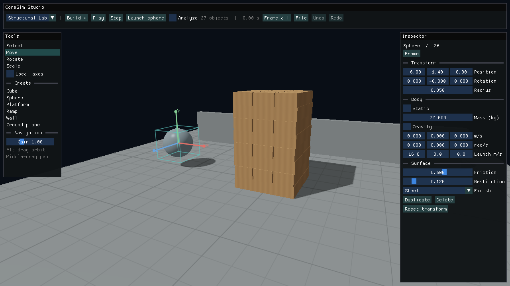
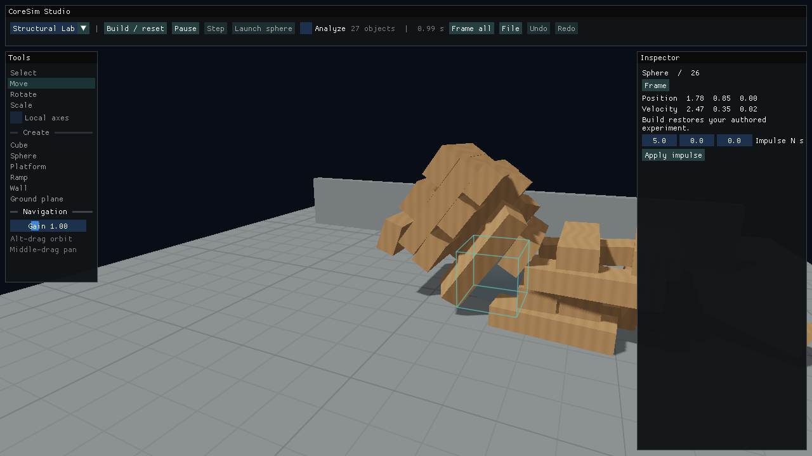

# CoreSim Studio

Launch `./build-studio/coresim` after building the app. **Structural Lab** opens in Build mode: a 24-beam wooden tower, static ground and backstop, and a selected 22 kg steel sphere. Click **Launch sphere** to start the simulation and release it. The structure is separate rigid bodies; there is no fracture or scripted collapse.

## Make an experiment

1. Choose **sandbox** in the scene selector. This opens a three-object editable experiment; the original 100-body preset is still **collision-demo**. Tower, Rain and Particle Storm remain available with their original playback and profiler controls.
2. Click a primitive in **Create**. Placement follows the camera's center ray to a hit or a short distance ahead. Cubes, platforms, walls and ramps use box colliders (a ramp is an inclined box). Spheres have uniform radius. Ground is an infinite static half-space; its finite slab shows the surface.
3. Click geometry to select it. The thin teal bounds mark selection; clicking empty space clears it. Use **Move**, **Rotate** or **Scale** and drag a labeled X/Y/Z handle along its screen direction. Move and rotate can use world or local axes; size changes always follow the object's own axes. Sphere scaling stays uniform. Numeric inspector fields provide precise values even when an axis points toward the camera.
4. In **Inspector**, edit position (metres), Euler rotation (degrees), half-extents/radius (metres), mass (kg), gravity, initial linear/angular velocities (m/s and rad/s), friction, restitution and visual finish. Physical coefficients and finish are independent. Static bodies have zero mass and no initial motion. Changing size updates physical dimensions; inertia is calculated from current mass and geometry.
5. **Play** advances the existing 120 Hz fixed-timestep solver. **Pause** stops ticking; **Step** advances exactly one tick while paused. Play/step lock authoring, but selection, navigation, live inspection and world-space impulses remain available. **Build / reset** restores authored objects, poses and initial motion. A reset does not save a falling body's pose over its starting pose.
6. In Build, open **File**, enter a path, and click **Save**. Open **File → Load** to restore it. Relative paths are relative to the directory from which Studio was launched. Try `scenes/ramp-drop.json` or `scenes/structural-lab.json` when launching from the repository. A successful load starts paused with the saved camera; validation failures leave the active experiment intact.

## Controls

| Action | Control |
|---|---|
| Select / Move / Rotate / Scale | Left palette or **1 / 2 / 3 / 4** |
| Fly / look | **WASD**, **Q/E**, hold **right mouse** to look |
| Orbit / pan / zoom | **Alt + left drag**, **middle drag**, **wheel** |
| Frame selected / scene | **F** or Inspector **Frame** / toolbar **Frame all** |
| Duplicate / delete | **Cmd/Ctrl+D** / **Delete** or **Backspace** |
| Undo / redo | **Cmd/Ctrl+Z** / **Cmd/Ctrl+Shift+Z**, or toolbar buttons |
| Play/pause / reset | **Space** / **R** |
| Leave Studio | **Esc** |

Framing sets the navigation pivot. Frame all fits finite bodies rather than attempting to fit an infinite plane. Orbit/dolly have distance limits; fly mode allows inspection from arbitrary positions. Axis drags and inspector edits operate in Build, after any prior worker jobs have joined. History stores up to 128 object-edit commands, coalesces drag updates, and restores logical selections across deletions without reviving stale world entity IDs. Camera navigation, simulation playback, the launch vector and opening files are outside object history.

**Analyze** shows frame history and FPS, scene CPU submission time, physics time, broad-phase and solver time, candidates, contact points and process peak RSS where supported. Physics/collision values describe the last collected fixed tick, not GPU time. The standalone [performance benchmarks](../BENCHMARKS.md) are separate workloads.

## Scene files and limitations

Schema 1 JSON stores authored transforms (quaternions in w,x,y,z order), primitive and shape dimensions, body and visual material settings, initial motion, projectile reference/launch vector, fixed rate, world gravity and camera pose. Shape IDs are cube/sphere/platform/ramp/wall/plane (0–5); finish IDs are steel/concrete/wood/rubber/plastic (1–5). The two sample files are portable examples. Save replaces its target by renaming a completed sibling temporary file. Load validates an isolated replacement before swapping worlds. Live solver contacts, motion in progress, undo history and selection are not serialized. The workspace limit is 2,048 objects; the reader limits file size to 2 MiB and nesting to 32 levels.

See the [implementation report](studio-redesign-report.md) for validation and technical limits.
