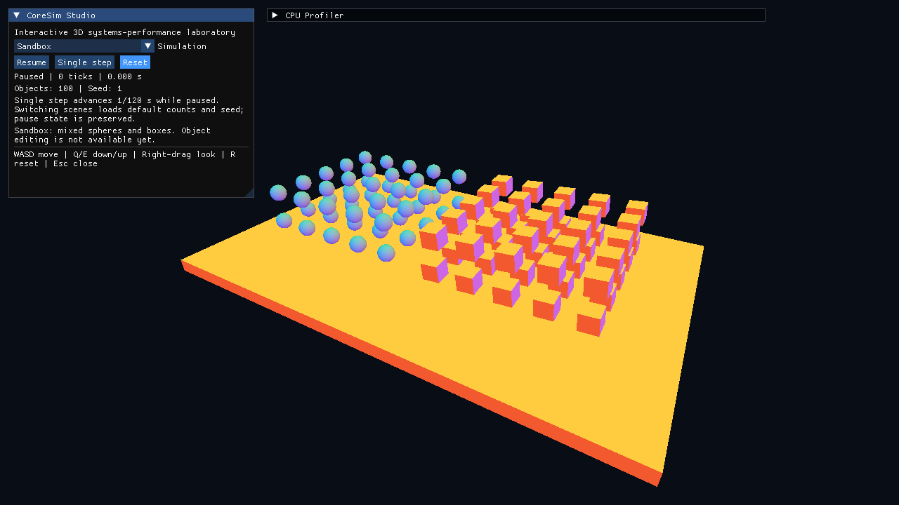

# CoreSim Studio — Milestone 17

Studio adds scene selection and playback controls to the native application. It is the first step of Studio V1, an interactive 3D systems-performance laboratory. Live configuration, algorithm switches, debug overlays and the redesigned performance dashboard belong to later milestones.

```sh
./build-release/coresim
./build-release/coresim --scene sandbox
./build-release/coresim --scene stress-tower
```

The existing collision demo opens as **Sandbox**. It contains 50 spheres and 50 boxes above a plane; this basic sandbox has no object editing, spawning, force tools or explosions. `sandbox` is a CLI alias of `collision-demo`, preserving existing scene construction and benchmark compatibility.



## Controls

- **Simulation:** switch between Tower (256 boxes), Rain (2,500 spheres), Particle Storm (25,000 independent CPU particles), and Sandbox (100 mixed bodies). Selecting a different entry rebuilds the scene using its default count and seed 1. Command-line counts/seeds apply to the initial scene; switching loads the selected preset defaults.
- **Pause / Resume:** freeze or resume physics while leaving the camera and interface responsive.
- **Single step:** advance exactly one 1/120-second physics tick while paused. Disabled while running. Each command is consumed once; it does not accumulate a background queue.
- **Reset / R:** restore initial motion, clear simulation ticks and dropped-time counters, and return the camera to its starting view. Reset preserves the selected scene, count, seed and pause state.
- **Camera:** WASD moves, Q/E moves vertically, right-drag looks around, Esc closes. Keyboard/mouse capture by the UI prevents camera/reset input from leaking through controls.

The Studio panel starts at the upper left; the existing CPU Profiler starts collapsed to its right. Both are movable/resizable ImGui windows. The profiler retains its existing cumulative semantics across scene switches; use its Reset statistics button for a fresh collection. Its collection switch does not pause simulation. Studio displays physics tick count and elapsed simulation time, not GPU timing or benchmark results.

## Transition and ownership rules

`StudioSession` owns a replaceable scene/physics pair without requiring graphics. The application draws controls before the simulation update; all physics jobs from the previous update have joined. Scene construction happens before the old state is replaced. Validation or allocation failure leaves the active scene intact and displays an error in the selector.

Switching scenes changes gravity with the scene (zero for particles), resets the fixed-step accumulator and counters, cancels pending manual steps, restores the camera, and preserves pause state. Entity IDs and component references belong to the old scene and must not be retained across a switch; the renderer borrows the current world each frame.

Paused wall time is discarded. Resume clears fractional accumulated time and ignores the control frame's elapsed duration. Reset/selection additionally ignore the following frame's elapsed duration because it includes the preceding rebuild work. This prevents scene construction or time spent paused from causing catch-up ticks. Manual steps remain available immediately while paused. Normal running retains the existing bounded fixed-step catch-up policy.

## Validation

Headless tests cover pause/step/resume, discarded paused time, reset of fractional time, repeated scene transitions, per-scene gravity, worker-backed stepping, exact initial-motion restoration, rejected transitions and invalid frame durations. Display tests click the actual Pause, Single step, Reset and Resume buttons and select all four scenes, while checking GL errors and rendered UI geometry. The screenshot above is an actual framebuffer capture of the same renderer and panels used by the application.

Studio V1 continues with Milestone 18 live configuration, 19 algorithm switches, 20 debug visualization, 21 the performance dashboard and 22 release validation. The previously planned GPU particle work moves to Studio V2 Milestone 23; HIP hardware validation remains pending. No accounts, cloud services or community features are included.
